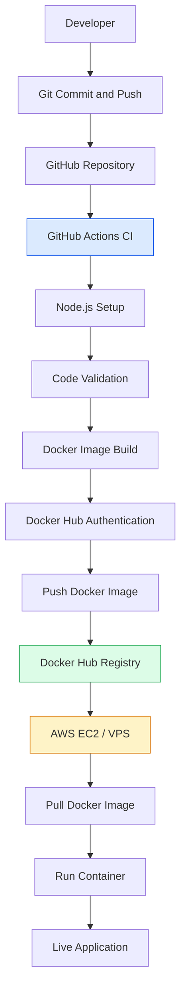

# 🚀 DevOps Intern Assessment Project

> A production-ready demonstration of application containerization, local orchestration, CI/CD automation, and automated Linux system health monitoring.

---

[](https://nodejs.org/)
[](https://www.docker.com/)
[](https://github.com/features/actions)
[](https://www.gnu.org/software/bash/)

---

## 📌 Project Overview

This project showcases a lightweight **Node.js REST API** packaged into a optimized Docker container, managed locally via **Docker Compose**, and continuously validated using **GitHub Actions CI/CD**. Additionally, it features a custom **Bash system monitor** for tracking host system health metrics.

### 🎯 Key Objectives

* **Application Development:** Build a clean, minimal RESTful API service.
* **Containerization:** Write an optimized, multi-stage `Dockerfile`.
* **Orchestration:** Configure `docker-compose.yml` for unified local management.
* **Continuous Integration:** Automate testing, linting, and building via GitHub Actions.
* **Registry Publishing:** Automatically build and push verified images to **Docker Hub**.
* **System Observability:** Implement a Bash daemon script to track CPU, Memory, and Disk utilization with timestamped logging.

---

## 🛠️ Technology Stack

| Domain | Technology | Core Purpose |
| :--- | :--- | :--- |
| **Runtime** | `Node.js 22` | Web API application server |
| **Containerization** | `Docker` | Application environment isolation |
| **Orchestration** | `Docker Compose` | Multi-container local management |
| **CI/CD Pipeline** | `GitHub Actions` | Automated build, test, and push workflows |
| **Registry** | `Docker Hub` | Public/Private container image repository |
| **Monitoring** | `Linux / Bash` | Automated host resource health logging |
| **VCS** | `Git` | Source code version control |

## Project Structure

```text
devops-intern-task/
│
├── src/
│   └── server.js
│
├── test/
│   └── server.test.js
│
├── docs/
│   └── ci-cd-workflow.png
│
├── scripts/
│   └── system_health.sh
│
├── .github/
│   └── workflows/
│       └── ci.yml
│
├── .dockerignore
├── .gitignore
├── Dockerfile
├── docker-compose.yml
├── package.json
├── package-lock.json
├── health_log.txt
└── README.md
```

## 1. Application

The application exposes a single GET endpoint.

**Endpoint:** `GET /`

**Local URL:** http://localhost:8080/

### Expected Response

```json
{
  "message": "Hello from DevOps Intern Task!",
  "status": "running"
}
```

The application returns HTTP 200 for the root endpoint and HTTP 404 for unknown routes.

## 2. Docker Containerization

The application is packaged using a lightweight official Node.js Alpine image.

### Docker Best Practices

- Lightweight Alpine base image.
- Production-only dependency installation.
- Non-root container execution.
- Docker health check.
- Minimal build context using `.dockerignore`.
- No application secrets embedded in the image.

### Run with Docker Compose

Build and start the application:

```bash
docker compose up -d --build
```

Check running containers:

```bash
docker ps
```

View application logs:

```bash
docker compose logs -f
```

Check container health:

```bash
docker inspect devops-intern-app \
  --format='{{.State.Health.Status}}'
```

Access the application:

http://localhost:8080/

Stop the application:

```bash
docker compose down
```

## 3. GitHub Actions CI Pipeline

The CI workflow is located at:

`.github/workflows/ci.yml`

### Pipeline Execution

The pipeline automatically triggers whenever code is pushed to the `main` branch.

Pipeline stages:

1. Checkout repository source code.
2. Set up Node.js 22.
3. Install dependencies using `npm ci`.
4. Validate JavaScript syntax.
5. Configure Docker Buildx.
6. Authenticate with Docker Hub.
7. Build the Docker image.
8. Push the image to Docker Hub.

### GitHub Repository Secrets

Configure the following secrets:

| Secret | Description |
|---|---|
| `DOCKERHUB_USERNAME` | Docker Hub username |
| `DOCKERHUB_TOKEN` | Docker Hub access token |

Navigate to:

`GitHub Repository → Settings → Secrets and variables → Actions`

**Never hardcode credentials or access tokens in source code.**

### Docker Hub Image

Repository:

`docker.io/YOUR_DOCKERHUB_USERNAME/devops-intern-task`

The workflow publishes two image tags:

- `latest`
- Git commit SHA

Pull the image:

```bash
docker pull YOUR_DOCKERHUB_USERNAME/devops-intern-task:latest
```

Run the image:

```bash
docker run -d \
  --name devops-intern-app \
  -p 8080:8080 \
  YOUR_DOCKERHUB_USERNAME/devops-intern-task:latest
```

The CI pipeline publishes the image automatically. VPS deployment is a separate deployment step described below.

## 4. CI/CD Architecture



## 5. Linux System Health Monitoring

The standalone Bash script is available at:

`scripts/system_health.sh`

It monitors the following Linux system metrics:

| Metric | Description |
|---|---|
| CPU Usage | CPU utilization percentage |
| Memory Usage | Used memory percentage |
| Disk Usage | Root filesystem utilization |

### Execute the Script

Run on a Linux machine or WSL Ubuntu:

```bash
chmod +x scripts/system_health.sh
```

Execute:

```bash
./scripts/system_health.sh
```

Alternatively:

```bash
bash scripts/system_health.sh
```

### Log Output

The script appends timestamped system metrics to:

`health_log.txt`

Example:

```text
[2026-11-05 21:30:10 +06] CPU: 12.50% | Memory: 45.30% | Disk: 65%
```

### Disk Usage Alert

If disk utilization exceeds 80%, the script displays:

```text
[WARNING] Disk space high!
```

The warning is also appended to the health log.

### View Health Logs

```bash
cat health_log.txt
```

View the latest entries:

```bash
tail -n 10 health_log.txt
```

## 6. AWS EC2 / VPS Deployment Approach

My deployment approach would be:

1. **Provision an EC2 instance:** Launch an Ubuntu Linux EC2 instance, configure SSH access and security groups, install Docker, and prepare the server environment.

2. **Pull and run the Docker image:** Authenticate with Docker Hub if necessary, pull the published application image, and run it on the EC2 instance using Docker. Configure the required network access and environment variables.

3. **Configure production access and monitoring:** Use Nginx as a reverse proxy, configure HTTPS using Let's Encrypt, and use the Bash health monitoring script with cron to monitor CPU, memory, and disk utilization.

The current GitHub Actions workflow automates image publishing to Docker Hub. Automatic VPS deployment can be implemented as a separate CD stage using secure SSH credentials or a self-hosted runner.

## 7. Useful Docker Commands

Build image:

```bash
docker build -t devops-intern-task .
```

List images:

```bash
docker images
```

List containers:

```bash
docker ps -a
```

Stop container:

```bash
docker stop devops-intern-app
```

Remove container:

```bash
docker rm devops-intern-app
```

Remove image:

```bash
docker rmi devops-intern-task
```

## 8. Security, Versioning and Testing

### Automated Vulnerability Scanning

Integrated Trivy vulnerability scanning into the GitHub Actions CI pipeline.

- Scans Docker images for OS and application library vulnerabilities.
- Detects Critical and High severity vulnerabilities.
- Fails the pipeline when configured security thresholds are exceeded.
- Skips unfixed vulnerabilities according to the configured scanning policy.

### Docker Image Versioning

Docker images are published with multiple tags:

- `latest` — Latest successful main branch build.
- `commit SHA` — Immutable reference to a specific source commit.
- `semantic version` — Release versions such as `v1.0.0` and `v1.1.0`.


## 9. Future Improvements

- Add automated deployment to AWS EC2.
- Add HTTPS and reverse proxy configuration.
- Integrate Prometheus and Grafana monitoring.
- Implement container image rollback.
- Add automated testing to the CI pipeline.


## 👤 Author

**Joni Miah**

* 🐙 **GitHub:** [@Abdullah1906](https://github.com/Abdullah1906) | [Repository](https://github.com/Abdullah1906/devops-intern-task)
* 🐳 **Docker Hub:** [@abdullah1438](https://hub.docker.com/u/abdullah1438) | [Image Repository](https://hub.docker.com/repository/docker/abdullah1438/devops-intern-task)

---

**Project Status:** ✅ Completed — Application, Containerization, CI Pipeline, Docker Hub Publishing, and Linux System Monitoring.

